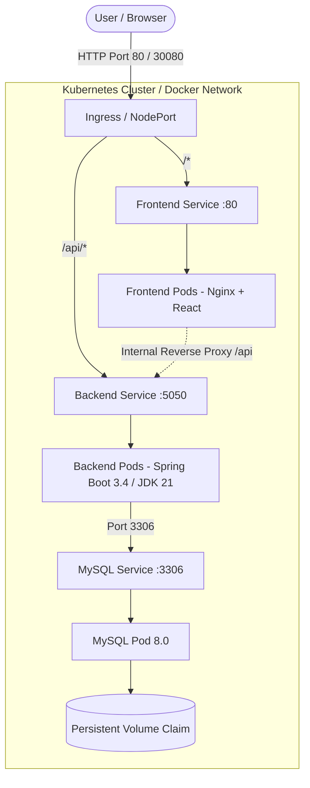
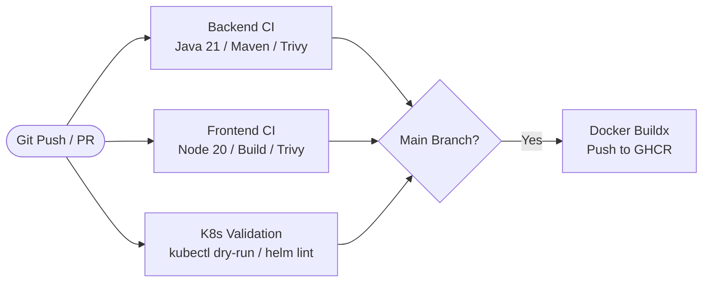

# Inventra - DevOps Architecture & Deployment Guide

This document describes the complete DevOps engineering setup implemented for **Inventra (Smart Inventory Management System)**, including containerization, local orchestration, Kubernetes deployment, Helm chart templating, and GitHub Actions CI/CD with DevSecOps practices.

---

## 1. DevOps Architecture Overview

The system is deployed using a 3-tier micro-architecture:
1. **Frontend Tier:** React Single Page Application served via an optimized Nginx web server.
2. **Backend Tier:** Spring Boot REST API (Java 21) exposing business logic and Spring Boot Actuator monitoring.
3. **Database Tier:** MySQL 8.0 with Persistent Volume Claim for persistent data storage.



---

## 2. Containerization (Docker)

### Multi-Stage Dockerfiles

Both the backend and frontend use **multi-stage builds** to ensure minimal image sizes, fast caching, and hardened security:

- **Backend (`backend/Dockerfile` & `backend/InventoryMgtSys/Dockerfile`):**
  - **Stage 1 (Builder):** Uses `maven:3.9.9-eclipse-temurin-21-alpine` to download dependencies and compile the `.jar` package.
  - **Stage 2 (Runtime):** Uses minimal `eclipse-temurin:21-jre-alpine`.
  - **DevSecOps:** Runs as an unprivileged non-root user (`appuser:appgroup`).
  - **Healthcheck:** Automated probe using Spring Boot Actuator `/actuator/health`.

- **Frontend (`frontend/Dockerfile`):**
  - **Stage 1 (Builder):** Uses `node:20-alpine` to install dependencies and run `vite build`.
  - **Stage 2 (Runtime):** Uses `nginx:1.27-alpine` to serve static assets with gzip compression.
  - **Reverse Proxy:** `nginx.conf` proxies `/api/` calls seamlessly to the backend service.
  - **Healthcheck:** Endpoint `/healthz` returning HTTP 200.

### Local Orchestration with Docker Compose

To run the complete stack locally in one command:

```bash
# 1. Copy the environment template
cp .env.example .env

# 2. Build and start containers
docker compose up -d --build

# 3. Check container status
docker compose ps
```

- **Frontend UI:** http://localhost:3000
- **Backend API:** http://localhost:5050/api
- **Actuator Health:** http://localhost:5050/actuator/health
- **MySQL Database:** `localhost:3306`

To shut down the stack:
```bash
docker compose down -v
```

---

## 3. Kubernetes Deployment (k8s/)

The `k8s/` directory contains cloud-native manifests organized by service:

| File / Folder | Resource Type | Description |
|---|---|---|
| `k8s/namespace.yaml` | `Namespace` | Creates isolated `inventra` namespace |
| `k8s/mysql/` | `Deployment`, `Service`, `Secret`, `PVC` | MySQL 8.0 with persistent volume claim and secret management |
| `k8s/backend/` | `Deployment`, `Service`, `ConfigMap`, `Secret` | High-availability backend (2 replicas, rolling updates, readiness & liveness probes) |
| `k8s/frontend/` | `Deployment`, `Service` | High-availability frontend (2 replicas, NodePort 30080, health probes) |
| `k8s/ingress.yaml` | `Ingress` | Nginx Ingress Controller rules routing traffic |
| `k8s/kustomization.yaml` | `Kustomization` | Single-command deployment bundle |

### Deploying to Kubernetes

Deploy using **Kustomize** (built into `kubectl`):

```bash
# Apply all manifests to your cluster
kubectl apply -k k8s/

# Monitor rollout status
kubectl rollout status deployment/mysql -n inventra
kubectl rollout status deployment/backend -n inventra
kubectl rollout status deployment/frontend -n inventra

# Inspect all resources
kubectl get all -n inventra
```

### Accessing the Application on Kubernetes
- **NodePort:** `http://<node-ip>:30080` (or `http://localhost:30080` on Docker Desktop / Minikube)
- **Ingress:** Map `inventra.local` to your ingress controller IP in your `/etc/hosts` or `C:\Windows\System32\drivers\etc\hosts`:
  ```
  127.0.0.1 inventra.local
  ```

---

## 4. Helm Chart (`helm/inventra/`)

For parameterized and repeatable deployments across different environments (Dev, Staging, Prod):

```bash
# Lint the chart
helm lint helm/inventra

# Dry-run installation
helm install inventra helm/inventra --dry-run --debug

# Install or upgrade release
helm upgrade --install inventra ./helm/inventra --namespace inventra --create-namespace
```

Values can be overridden using `--set` or a custom values file:
```bash
helm upgrade --install inventra ./helm/inventra \
  --set backend.replicaCount=3 \
  --set frontend.replicaCount=3
```

---

## 5. CI/CD Pipeline (GitHub Actions)

Workflow file: `.github/workflows/ci-cd.yml`



### Stages:
1. **Backend CI:**
   - JDK 21 setup with Maven dependency caching.
   - Executes `mvn clean test` for automated testing.
   - **DevSecOps:** Runs Aqua Security **Trivy** to scan backend dependencies for vulnerabilities.
2. **Frontend CI:**
   - Node 20 setup with npm caching.
   - Clean dependency installation (`npm ci`).
   - Production bundle build (`npm run build`).
   - **DevSecOps:** Runs **Trivy** to scan frontend dependencies.
3. **Kubernetes Validation:**
   - Runs `kubectl apply --dry-run=client -k k8s/` to catch syntax and API version errors.
   - Runs `helm lint helm/inventra`.
4. **Continuous Delivery (CD):**
   - Automatically builds multi-arch container images using `docker/setup-buildx-action`.
   - Tags and publishes images to **GitHub Container Registry (`ghcr.io`)**:
     - `ghcr.io/<owner>/inventra-backend:latest`
     - `ghcr.io/<owner>/inventra-frontend:latest`

---

## 6. Helper Scripts

Automated deployment scripts are provided in `scripts/`:

- **Windows PowerShell:**
  - `.\scripts\docker-run.ps1` - Spins up the complete Docker Compose stack.
  - `.\scripts\k8s-deploy.ps1` - Deploys all manifests to your active Kubernetes cluster.

- **Linux / macOS Bash:**
  - `./scripts/docker-run.sh`
  - `./scripts/k8s-deploy.sh`
